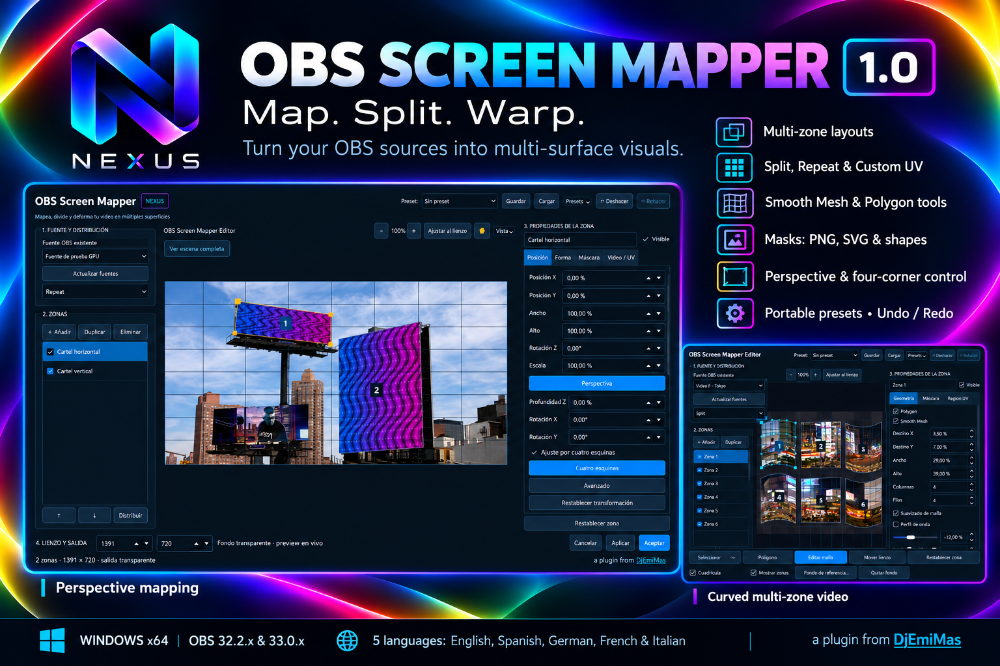
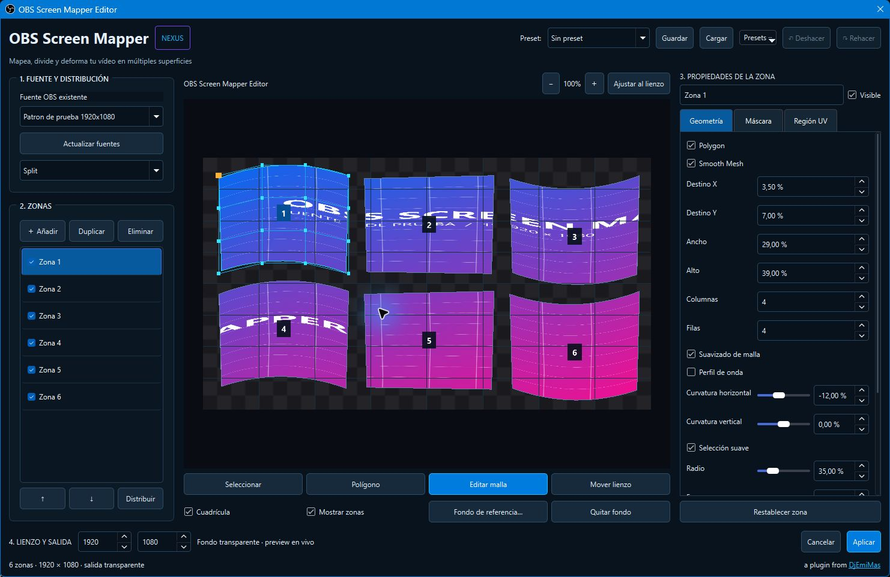
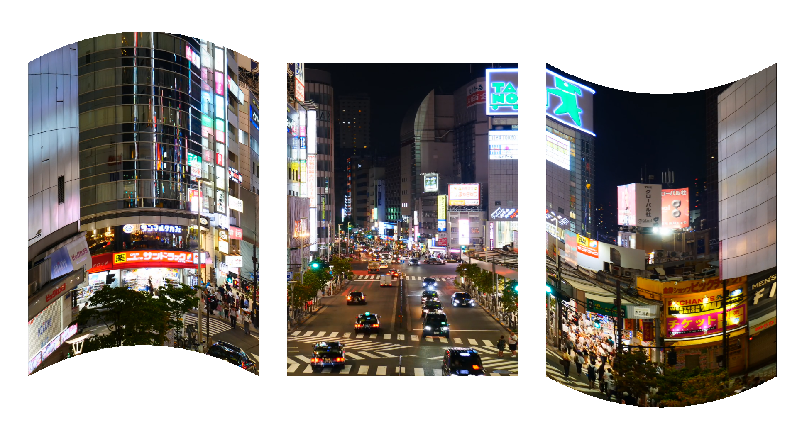
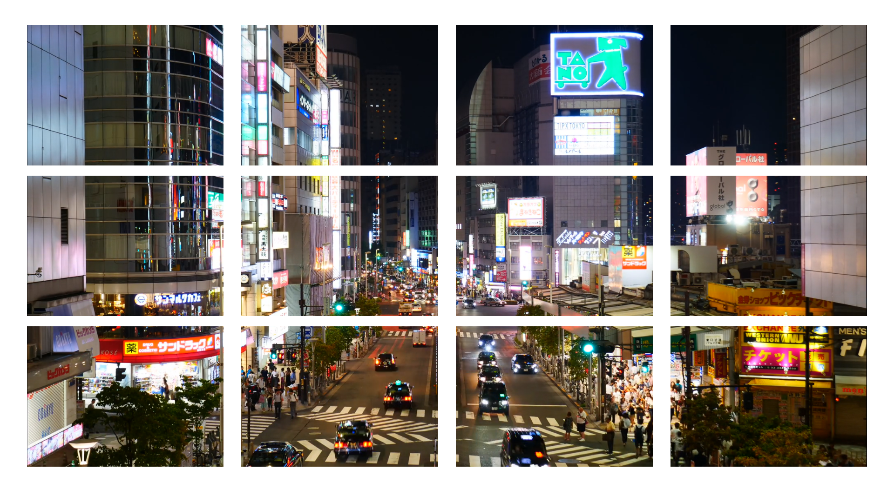
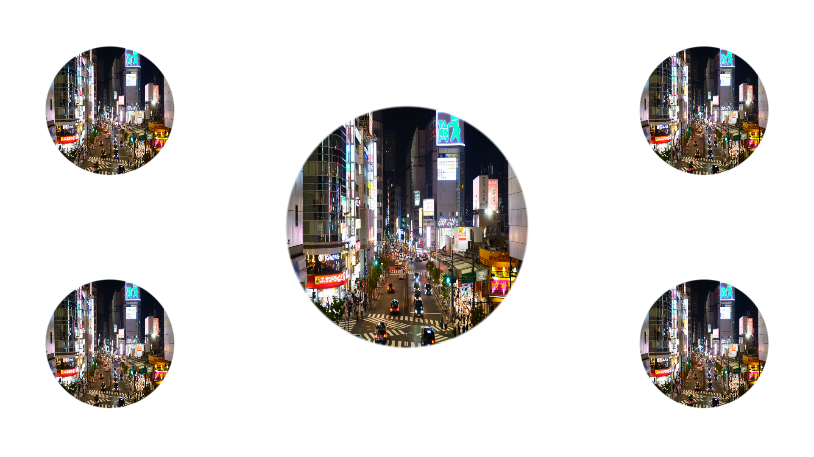

# OBS Screen Mapper NEXUS 1.0

**Map. Split. Warp.** Turn existing OBS video, camera, image and scene sources into multi-surface visuals with a native Windows x64 source and an integrated editor. Mapper reuses the selected source texture; it does not create another video player.

**[Download the official 1.0 release](https://github.com/Emidj/obs-screen-mapper-nexus/releases/tag/v1.0)**

## Features

- Dynamic zones: add, duplicate, hide, delete and reorder surfaces; no fixed six-zone limit.
- **Split, Repeat and Custom UV** layouts to spread one source across surfaces or repeat it independently.
- **Polygon and Smooth Mesh** tools that work together, with curvature and soft control-point selection.
- **Rectangle, ellipse, PNG and SVG masks**, with alpha/luminance modes, inversion, strength and editable shape geometry.
- Mesh adaptation to the crop without initially deforming the content.
- Position, scale, pivot, depth, XYZ rotation, perspective and four-corner controls.
- Live preview with a transparent output canvas, grid, zoom and zone overlays.
- Isolated source preview or full-scene reference, including nested groups.
- Portable presets with included resources, starter layouts, undo/redo and persistent editor state.
- Three-panel editor and compact OBS properties, localized in English, Spanish, German, French and Italian.

## Real examples

*Actual editor capture with a native test-pattern source, Polygon and Smooth Mesh controls. The screenshot uses Spanish; the editor follows the OBS language.*

*Three curved surfaces with Custom UV mapping, rendered by the real plugin using a supplied sample video frame. Checkerboard indicates transparency.*

*A 4 × 3 video wall with twelve zones and Custom UV mapping.*

*Five zones with ellipse masks. These renderer previews demonstrate layout and masking; they are not evidence of a live broadcast.*

## Compatibility

- **Windows x64; OBS Studio 32.2.x and 33.0.x**, standard installations.
- Checked versions: 32.2.0, 32.2.1, 32.2.2, 33.0.0 and 33.0.1.
- OBS 31.x, 32.0.x and 32.1.x are not supported by this package.
- The shared installer does not install into portable OBS and does not bundle OBS, Qt or Microsoft runtimes.
- macOS is a separate development project and is not part of this Windows release.

## Install or update

1. Close OBS Studio.
2. Run `OBS-Screen-Mapper-1.0-Windows-x64-Setup.exe` from the release.
3. Confirm your OBS folder and choose **Install / Update**.
4. Reopen OBS and add **OBS Screen Mapper** from Sources, then select an existing OBS input and open the editor.

The installer selects its language from Windows (English fallback). Administrator rights are required for the shared plugin location. Updates back up replaced plugin files and preserve scenes, profiles and presets. To uninstall, close OBS and use the same installer or Windows Apps. User settings, presets, unrelated files and backups are preserved. Installation and removal refuse to proceed while OBS is running.

**Apply** saves without closing; **OK** saves and closes; **Cancel** discards changes made since the last Apply. Importing a preset does not replace your chosen OBS input source.

## Scene reference behavior

The editor creates a private composition that shares video sources. Filters on copied scene/group containers are omitted only from this reference, with a visible notice, to avoid filter-related deadlocks. Original OBS output filters remain active and shared source filters are retained. The reference does not show the visual effect of omitted container filters.

## Validation and limits

Development evidence covers isolated libobs/Qt and D3D11 hosts, lifecycle, rendering, editor, presets, languages and installer upgrade/removal. OBS 33.0.1 checks recorded 312 lifecycle, 292 GPU and 199 editor passes; the isolated 0.5 Beta → 1.0 installer upgrade preserved presets and backed up both plugin DLLs. Publication checks verify packages and source contents; they do not repeat a live broadcast or prove compatibility on every GPU.

Image validation is SDR. HDR, graphics-device changes and other hardware/drivers require specific checks. Masks and presets load synchronously. Historical phase documents retain earlier versions and counts; they do not describe the final 1.0 release by themselves. The installer is unsigned.

## Source and license

See [BUILD.md](BUILD.md) for dependencies, build and packaging. The release includes the corresponding source ZIP, installer, runtime archive and SHA-256 checksums. Technical development documents are retained in their original language.

Original project code: **GPL-2.0-or-later**. See [LICENSE.txt](LICENSE.txt), [NOTICE.txt](NOTICE.txt) and [THIRD-PARTY-NOTICES.md](THIRD-PARTY-NOTICES.md). OBS Studio is an independent project; this plugin is not an official OBS product.

a plugin from [DjEmiMas](https://discord.gg/dhcqZPDYh)
